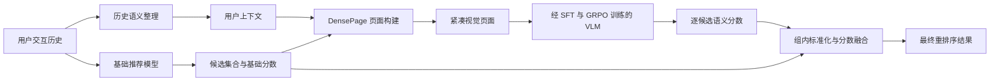
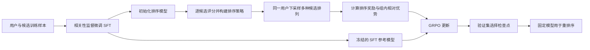

<div align="center">

# Zip4Rec

### 融合历史信息光学压缩与 GRPO 训练的高 token 效率推荐重排序框架

将用户交互历史转换为紧凑视觉上下文，并通过面向排序的 GRPO 训练增强视觉语言模型的重排序决策能力。

</div>

---

## 项目简介

推荐重排序旨在根据用户交互历史建模用户偏好，优化已有候选物品的排列顺序。大模型能够利用丰富的历史上下文完成这一任务，但仍面临两个关键挑战：多个用户的长交互历史会带来较大的输入 token 开销；未经推荐任务适配的通用视觉语言模型在重排序任务上表现不足，难以可靠地确定候选物品的优先次序。

为此，我们提出 **Zip4Rec**，一个融合历史信息光学压缩与面向排序的决策模型训练的推荐重排序框架。Zip4Rec 将历史上下文及相关物品语义组织为紧凑的视觉表示，并将视觉语言模型适配为重排序决策模型：先通过监督微调建立用户与物品的相关性判断能力，再使用 **GRPO（Group Relative Policy Optimization，组相对策略优化）**，根据候选排列的排序奖励优化模型。

本文将紧凑视觉页面称为 **DensePage**。Zip4Rec 是整体框架名称，DensePage 是其视觉输入表示。

| 关键挑战 | 影响 | Zip4Rec 的方法 |
| --- | --- | --- |
| 多用户长历史上下文带来较大的输入 token 开销 | 限制可利用的历史信息量，提高上下文处理成本 | 通过光学压缩将历史相关语义组织为紧凑视觉表示 |
| 通用 VLM 在推荐重排任务上表现不足 | 候选优先次序判断不准，直接重排可能弱于基础推荐模型的原始排序 | 通过推荐任务监督微调与 GRPO 排序训练，将通用 VLM 适配为重排序决策模型 |

Zip4Rec 接收基础推荐模型生成的候选集合，对集合内物品重新排序；候选生成仍由基础推荐模型完成。

## 研究动机

### 长历史上下文的 token 开销

将用户交互记录、物品标题、类别与描述直接拼接为文本，会消耗大量输入 token。随着用户数量与历史长度增加，这一成本会进一步累积。

Zip4Rec 将用于推荐判断的历史语义组织为视觉页面，使 VLM 能够通过视觉 token 读取这些信息。页面构建结合语义分区、字段组织、紧凑排版与动态尺寸，减少冗余表达和无效空白。

光学压缩的核心是改变上下文的承载形式。历史摘要、字段筛选和页面排版本身仍可能影响信息保留程度；token 节省应通过相同信息范围下的实际模型输入统计进行评估，包括视觉 token 与剩余文本 token。

### 通用 VLM 在推荐重排任务上的表现不足

通用视觉语言模型具备视觉内容理解和语义分析能力，但直接将其用于推荐重排，并不能保证良好的排序效果。推荐重排要求模型结合用户交互历史，判断同一候选集合中哪些物品更符合该用户的偏好；理解页面和物品内容，并不意味着能够可靠地确定用户条件下的候选优先次序。

项目中的未微调基模对照体现了这一问题：在 CDs & Vinyl 的 LightGCN Top-10 自然命中测试用户上，直接使用 Qwen3-VL-8B-Instruct 对 DensePage 逐候选评分，NDCG@10 为 0.46280，低于 LightGCN 原始排序的 0.54372。Video Games 的 LightGCN 和 SASRec 分支也出现了未微调 VLM 重排弱于基础模型原序的情况。这说明，在当前输入和评分设置下，仅将历史上下文组织为视觉页面，仍不足以让通用 VLM 直接胜任推荐重排。

因此，Zip4Rec 在光学压缩之外，进一步面向推荐任务训练视觉语言模型：通过监督微调学习用户历史与候选物品之间的偏好关联，再通过 GRPO 利用候选排列的排序奖励优化决策能力，使模型能够更有效地利用历史上下文完成重排序。

## 方法概览

### 推理流程



推理时使用已训练好的模型评分并排序。GRPO 在训练阶段更新模型参数，不是每次推荐请求中的在线优化步骤。

### 训练流程



## 方法组成

### 符号与候选生成

记用户为 $u$，可用交互历史为 $\mathcal H_u$，物品库为 $\mathcal I$，基础推荐模型对物品 $i$ 的分数为 $b_{u,i}$。候选数量记为 $K$，最终展示数量记为 $L\le K$；两者分别对应召回范围与输出截断位置。

对已核验的自然召回流程，先排除历史中已交互的物品，再按基础分数选取候选：

$$
\mathcal C_u
=\operatorname{TopK}_{i\in\mathcal I\setminus\operatorname{Items}(\mathcal H_u)}
\,b_{u,i},
\qquad |\mathcal C_u|=K.
$$

重排序只改变 $\mathcal C_u$ 内的顺序，不向候选集合注入测试目标。现有实验包含十候选与扩展候选规模的配置，公式中的 $K$ 取对应实验值。

### 基于交互历史的语义上下文

框架将物品元数据整理为结构稳定的语义表示，包括标题、类别、关键属性和内容摘要等。相同物品的语义资产可以离线生成并复用。

用户上下文结合长期偏好与近期交互：长期偏好概括相对稳定的兴趣，近期交互保留具体物品及其顺序。画像内容以可用历史为依据，具体字段与历史范围取决于数据集及输入构建配置。

这一过程可表示为：

$$
c_u=\operatorname{Organize}(p_u,q_u)
=\operatorname{Organize}\!\left(
\operatorname{Profile}(\mathcal H_u),
\operatorname{Recent}(\mathcal H_u)
\right).
$$

其中，$p_u=\operatorname{Profile}(\mathcal H_u)$ 是从可用历史归纳的长期偏好画像，$q_u=\operatorname{Recent}(\mathcal H_u)$ 是按原有顺序保留的近期交互，$c_u$ 是二者组织成的用户语义上下文。Organize 表示按照输入模板组织这些内容；画像字段与近期交互范围由数据集和配置确定。

多用户指框架处理多个用户的推荐请求；每个请求仍依据该用户的历史和候选集合构建输入，并不要求将多个用户混入同一张页面。

### DensePage 视觉页面构建

页面构建模块将用户上下文与候选物品语义组织为紧凑视觉输入。在逐候选实现中，每条模型输入对应一个用户与一个候选物品，具体图文组织方式由数据配置决定。

```text
读取用户上下文与候选语义
          ↓
划分语义区域并统一字段顺序
          ↓
测量换行、区域高度与页面尺寸
          ↓
渲染视觉页面并检查输入一致性
```

页面中的视觉信息主要来自历史和物品语义的排版表示，不以物品实拍图片为必要输入。这里的页面构建是数据处理与渲染流程。

将上述输入构建过程记为：

$$
\begin{aligned}
d_i&=\operatorname{Semantic}(m_i),&
V_{u,i}&=\operatorname{Render}(c_u,d_i),\\
x_{u,i}&=\operatorname{Processor}(t_{u,i},V_{u,i}),
&&i\in\mathcal C_u.
\end{aligned}
$$

其中 $m_i$ 是物品元数据，$d_i$ 是物品语义表示，$c_u$ 沿用上文定义的用户语义上下文；$t_{u,i}$ 表示指令及按配置保留在文本侧的上下文。Render 表示按实际布局构建页面，不要求每个量都占用独立区域。模型每次读取一个用户与一个候选对应的 $x_{u,i}$，评分输入不包含交互标签或测试目标标记。

### 面向推荐的视觉语言模型

当前逐候选实现使用 Qwen3-VL 和语言部分的 LoRA 适配参数，利用受限的 A/B 输出计算相关性分数。其中 A 对应交互正例，B 对应未交互候选标签；未交互候选作为弱负例使用，不等同于用户明确不喜欢的物品。

实现中先计算适配模型相对于冻结基座的 A/B logit 增量，再以两类增量之差作为候选语义分数。该分数是排序信号，不是经过概率校准的点击率。

具体地，令 $\theta_0$ 为关闭 LoRA 的冻结基座参数，$\theta$ 为某个固定检查点的适配模型参数。在提示的最后一个有效位置提取隐藏状态 $h_\theta(x_{u,i})$，仅计算 A/B 两个输出：

$$
\ell_\theta^v(x_{u,i})
=w_v^\top h_\theta(x_{u,i})+a_v,
\qquad v\in\{A,B\},
$$

其中 $w_v$ 与 $a_v$ 为输出头对应的权重与偏置；输出头没有偏置时取 $a_v=0$。定义基座校准后的类别增量与语义分数：

$$
\begin{aligned}
\Delta_\theta^v(u,i)
&=\ell_\theta^v(x_{u,i})-\ell_{\theta_0}^v(x_{u,i}),\\
s_\theta(u,i)
&=\Delta_\theta^A(u,i)-\Delta_\theta^B(u,i)\\
&=\bigl[\ell_\theta^A-\ell_\theta^B\bigr](x_{u,i})
-\bigl[\ell_{\theta_0}^A-\ell_{\theta_0}^B\bigr](x_{u,i}).
\end{aligned}
$$

这对应评分文件中的 delta_logit_A、delta_logit_B 和 condition_score。基座输出与适配模型使用同一输入，符合输入及运行环境检查的基座结果可以缓存复用。这里减去的是未适配基座输出；GRPO 中用于 KL 正则的冻结 SFT 参考策略承担不同作用。

| 训练阶段 | 学习目标 | 作用 |
| --- | --- | --- |
| 相关性监督微调（SFT） | 学习用户条件下的正负候选判别 | 建立推荐任务的基础相关性判断能力 |
| 面向排序的 GRPO 训练 | 根据采样排列的奖励优化候选相对顺序 | 将模型更新与候选集合的排序质量联系起来 |

### 基于 GRPO 的排序策略优化

Zip4Rec 使用 **GRPO** 进行排序训练。策略的动作是从剩余候选中依次选择物品，形成候选排列；VLM 提供候选分数，排列由分数定义的排序策略产生。

1. **构建排序策略。** 对同一用户的候选分数进行组内标准化，并按实验配置决定是否加入基础推荐分数，得到 Plackett–Luce 排序策略。
2. **采样候选排列。** 从采样时的策略中，为同一用户的候选集合采样多种排列。
3. **计算排序奖励。** 根据交互正例在采样排列中的位置计算奖励。已核验的单正例、十候选配置使用 NDCG@10，即正例排名为 `r` 时，奖励为 `1 / log2(r + 1)`。
4. **计算组内相对优势。** 对同一用户下多次采样的奖励进行中心化和标准化。这里的“组”是同一用户对应的多次排列采样；若组内奖励完全相同，该组的相对优势置零。
5. **更新模型。** 使用当前策略与采样时策略的逐步动作概率比，构造带裁剪的 GRPO 目标，并反向更新 VLM 的可训练适配参数。GRPO 使用组内奖励构造优势，不需要训练独立的价值模型。

上述过程的数学形式如下。沿用前文的候选集合 $\mathcal C_u$、语义分数 $s_\theta(u,i)$ 与组内标准化 $z_u$；记每个用户采样的排列数为 $G$，训练批次的用户请求集合为 $\mathcal B$。$\theta_{\mathrm{old}}$ 表示采样时的策略快照，$\theta_{\mathrm{ref}}$ 表示始终冻结的 SFT 参考模型，两者与未适配基座 $\theta_0$ 分别承担不同作用。

**排序策略与排列采样。** 训练时的策略分数定义为：

$$
f_\theta^{\mathrm{tr}}(u,i)=
\begin{cases}
z_u\bigl(s_\theta(u,i)\bigr),&\text{纯语义策略},\\
z_u(b_{u,i})+\alpha_{\mathrm{tr}}z_u\bigl(s_\theta(u,i)\bigr),
&\text{融合策略}.
\end{cases}
$$

其中 $\alpha_{\mathrm{tr}}$ 为训练配置指定的融合系数。基础推荐分数固定，梯度通过语义分数及其标准化传回可训练模型。训练实现要求语义分数具有非零方差；退化为常数的语义分数组会报错检查，区别于推理时的零向量回退。

在剩余候选集合 $\mathcal S$ 中选择物品的概率，以及一个完整排列 $\boldsymbol\sigma=(\sigma_1,\ldots,\sigma_K)$ 的概率为：

$$
\begin{aligned}
p_\theta(i\mid u,\mathcal S)
&=\frac{\exp\bigl(f_\theta^{\mathrm{tr}}(u,i)/\tau\bigr)}
{\sum_{j\in\mathcal S}\exp\bigl(f_\theta^{\mathrm{tr}}(u,j)/\tau\bigr)},\\
\pi_\theta(\boldsymbol\sigma\mid u)
&=\prod_{j=1}^{K}p_\theta(\sigma_j\mid u,\mathcal S_j),
\qquad
\mathcal S_j=\mathcal C_u\setminus\{\sigma_1,\ldots,\sigma_{j-1}\},\\
\boldsymbol\sigma_u^{(g)}
&\sim\pi_{\theta_{\mathrm{old}}}(\cdot\mid u),
\qquad g=1,\ldots,G.
\end{aligned}
$$

$\tau>0$ 为采样温度。代码通过 Gumbel 扰动实现上述 Plackett–Luce 排列采样，不需要 VLM 逐词生成排序文本。

**排序奖励与组内相对优势。** 在每组含一个交互正例的训练设置中，令其在第 $g$ 个采样排列中的排名为 $r_{u,g}$：

$$
\begin{aligned}
R_{u,g}&=\mathrm{NDCG@}K(\boldsymbol\sigma_u^{(g)})
=\frac{1}{\log_2(r_{u,g}+1)},\\
\overline R_u&=\frac{1}{G}\sum_{g=1}^{G}R_{u,g},\qquad
\sigma_{R,u}=\sqrt{\frac{1}{G}\sum_{g=1}^{G}(R_{u,g}-\overline R_u)^2},\\
\widehat A_{u,g}&=
\begin{cases}
\dfrac{R_{u,g}-\overline R_u}{\sigma_{R,u}+\varepsilon_A},
&\sigma_{R,u}>0,\\
0,&\sigma_{R,u}=0.
\end{cases}
\end{aligned}
$$

已核验的基础 GRPO 配置取 $K=10$、$\varepsilon_A=10^{-6}$。同一排列各有效选择步骤共享 $\widehat A_{u,g}$；奖励和优势在策略更新中作为固定量使用，不对其反向求导。相对优势仅在同一用户的 $G$ 个排列之间计算。

**逐步概率比与裁剪损失。** 对已经采样的排列，使用同一剩余候选集合比较当前策略与采样策略：

$$
\rho_{u,g,j}(\theta)
=\frac{
p_\theta(\sigma_{u,j}^{(g)}\mid u,\mathcal S_{u,g,j})
}{
p_{\theta_{\mathrm{old}}}(\sigma_{u,j}^{(g)}\mid u,\mathcal S_{u,g,j})
},
\qquad
\mathcal S_{u,g,j}
=\mathcal C_u\setminus
\{\sigma_{u,1}^{(g)},\ldots,\sigma_{u,j-1}^{(g)}\}.
$$

定义裁剪后的单步代理目标及最小化的 GRPO 损失：

$$
\begin{aligned}
\ell_{u,g,j}^{\mathrm{clip}}(\theta)
&=\min\!\left(
\rho_{u,g,j}(\theta)\widehat A_{u,g},
\operatorname{clip}\bigl(\rho_{u,g,j}(\theta),1-\epsilon,1+\epsilon\bigr)
\widehat A_{u,g}
\right),\\
\mathcal L_{\mathrm{GRPO}}(\theta)
&=-\frac{1}{|\mathcal B|}\sum_{u\in\mathcal B}
\frac{1}{G}\sum_{g=1}^{G}
\sum_{j=1}^{K-1}m_{u,g,j}\,
\ell_{u,g,j}^{\mathrm{clip}}(\theta).
\end{aligned}
$$

$\epsilon$ 为概率比裁剪范围，$m_{u,g,j}$ 为有效动作掩码。基础八组对照实现对前 $K-1$ 步取 $m_{u,g,j}=1$；最后一步只剩一个候选，概率恒为 1，因此不计入损失。启用“正例终止”配置的后续实验只累计到选出正例为止，即取 $m_{u,g,j}=\mathbf 1[j\le r_{u,g}]$。实现对有效步骤求和，再对采样排列和用户请求取平均，没有额外除以有效步骤数；概率比也不是整个排列概率之比。

已核验实现还包含两个辅助项：

- **KL 正则项：** 约束当前策略相对于冻结 SFT 参考策略的偏移。具体实现计算首个候选选择的分类分布 KL，不是完整排列分布的 KL。
- **SFT 回放项：** 在排序训练中继续使用原有加权正负样本对的相关性监督，以帮助保留基础匹配能力。

首选候选分布记为 $p_\theta^{(1)}(i\mid u)=p_\theta(i\mid u,\mathcal C_u)$。在与当前策略相同的分数构造方式和温度下，由冻结 SFT 模型得到 $p_{\mathrm{ref}}^{(1)}$，KL 项为：

$$
\mathcal L_{\mathrm{KL}}(\theta)
=\frac{1}{|\mathcal B|}\sum_{u\in\mathcal B}
\sum_{i\in\mathcal C_u}p_\theta^{(1)}(i\mid u)
\log\frac{p_\theta^{(1)}(i\mid u)}
{p_{\mathrm{ref}}^{(1)}(i\mid u)}.
$$

这对应 $D_{\mathrm{KL}}(p_\theta^{(1)}\Vert p_{\mathrm{ref}}^{(1)})$，方向为当前策略到冻结参考策略。它在候选集合的首选分类分布上精确求和，不是完整 PL 排列分布的 KL。

令 $\boldsymbol\Delta_\theta(u,i)=(\Delta_\theta^A(u,i),\Delta_\theta^B(u,i))$，原始回放样本对为 $(i_u^+,A)$ 与 $(i_u^-,B)$，负例回放权重为 $w_u$。回放损失为：

$$
\begin{aligned}
\operatorname{CE}(\boldsymbol\Delta,y)
&=-\log\frac{\exp(\Delta^y)}{\exp(\Delta^A)+\exp(\Delta^B)},\\
\mathcal L_{\mathrm{replay}}(\theta)
&=\frac{1}{|\mathcal B|}\sum_{u\in\mathcal B}\frac{1}{2}
\left[
\operatorname{CE}(\boldsymbol\Delta_\theta(u,i_u^+),A)
+w_u\,\operatorname{CE}(\boldsymbol\Delta_\theta(u,i_u^-),B)
\right].
\end{aligned}
$$

这里 $i_u^-$ 是原始回放样本对中的未交互候选，不是将全部弱负例平均。启用 FP32 bridge 的实验分支应使用该分支实际校准后的类别增量。

基础 GRPO 配置的总训练目标为：

$$
\boxed{
\mathcal L_{\mathrm{total}}(\theta)
=\lambda_{\mathrm{task}}\mathcal L_{\mathrm{GRPO}}(\theta)
+\beta\,\mathcal L_{\mathrm{KL}}(\theta)
+\lambda_{\mathrm{replay}}\mathcal L_{\mathrm{replay}}(\theta)
}
$$

模型通过最小化该损失更新可训练 LoRA 参数。基础八组对照中的 GRPO 运行使用 $\lambda_{\mathrm{task}}=1$、$\beta=0.02$、$\lambda_{\mathrm{replay}}=0.1$；这些数值属于对应实验配置，不是 GRPO 方法本身的固定要求。后续实验若启用额外约束或优势缩放变体，应以相应配置另行记录。

### 语义分数与基础推荐分数融合

在融合配置下，最终排序结合基础推荐模型分数与 VLM 语义分数：

```text
基础推荐分数 ──> 用户候选集合内标准化 ──┐
                                      ├──> 加权求和 ──> 按分数降序排序
VLM 语义分数 ──> 用户候选集合内标准化 ──┘
```

基础推荐模型提供行为相关信号，VLM 提供历史上下文与物品内容的语义匹配信号。融合形式为 `z(基础推荐分数) + α × z(VLM 语义分数)`，其中 `z` 表示同一用户候选集合内的标准化，`α` 由实验协议固定或根据验证集选择。

对任一候选分数 $a_{u,i}$，实现使用候选集合内的总体均值与总体标准差：

$$
\begin{aligned}
\mu_u(a)&=\frac{1}{K}\sum_{j\in\mathcal C_u}a_{u,j},\\
\sigma_u(a)&=\sqrt{\frac{1}{K}\sum_{j\in\mathcal C_u}
\bigl(a_{u,j}-\mu_u(a)\bigr)^2},\\
z_u(a_{u,i})&=
\begin{cases}
\dfrac{a_{u,i}-\mu_u(a)}{\sigma_u(a)},&\sigma_u(a)>10^{-12},\\
0,&\sigma_u(a)\le 10^{-12}.
\end{cases}
\end{aligned}
$$

这里的分母是 $K$，并非样本标准差使用的 $K-1$；阈值用于处理近乎常数的分数，正常分支不额外在分母上加平滑项。标准化分别作用于基础分数和语义分数，并在每个用户的当前候选集合内完成。

融合分数与最终输出为：

$$
\begin{aligned}
F_{\theta,\alpha}(u,i)
&=z_u(b_{u,i})+\alpha\,z_u\bigl(s_\theta(u,i)\bigr),\\
\widehat{\pi}_u
&=\operatorname{Sort}_{i\in\mathcal C_u}
\bigl(-F_{\theta^\star,\alpha^\star}(u,i),\operatorname{ID}(i)\bigr),\\
\widehat{\mathcal R}_u^{(L)}
&=(\widehat{\pi}_{u,1},\ldots,\widehat{\pi}_{u,L}).
\end{aligned}
$$

Sort 按括号中的键升序排列，即融合分数降序、同分时物品 ID 升序。$\theta^\star$ 与 $\alpha^\star$ 是预先锁定的检查点和融合系数。纯语义评估直接按 $s_\theta$ 排序；融合公式中取 $\alpha=0$ 则得到基础模型排序。

对于联合选择检查点与融合系数的实验，已有流水线使用验证集上的字典序规则：

$$
(t^\star,\alpha^\star)
=\underset{t\in\mathcal T,\ \alpha\in\mathcal A}{\operatorname{arg\,max}_{\mathrm{lex}}}
\Bigl(
\mathrm{NDCG@10}_{\mathrm{val}}(t,\alpha),
\mathrm{MRR@10}_{\mathrm{val}}(t,\alpha),
\mathrm{H@1}_{\mathrm{val}}(t,\alpha),
-t,-\alpha
\Bigr),
\qquad \theta^\star=\theta_{t^\star}.
$$

即优先比较验证集 NDCG@10，再比较 MRR@10、H@1，仍相同时优先更早的检查点和更小的融合系数。$\mathcal T$、$\mathcal A$ 是协议声明的候选集合；若包含 $t=0$，它表示 SFT 初始化，也可能被选中。固定融合实验的 $\mathcal A$ 只有一个值；候选规模扩展实验直接沿用已选模型与系数，不重新搜索。

从 Top-10 扩展为 Top-50 或 Top-100 时，即使某个用户与候选的页面和原始语义分数保持不变，也必须在新的完整候选集合上重算两类分数的 $\mu_u$、$\sigma_u$ 与融合结果，不能直接复用原集合的标准化分数。

训练策略可以使用纯语义分数或融合分数，复现时应以相应运行配置为准。推理阶段直接使用锁定的检查点和融合规则生成最终顺序，无需再次采样或执行 GRPO 更新。

### 推理结果的实验评估

现有单正例评估中，令留出交互物品为 $i_u^+$，其在最终候选排序中的位置为 $r_u$；若 $i_u^+\notin\mathcal C_u$，记 $r_u=\infty$，各指标贡献为零。对有限排名，截断到前 $L$ 位的指标为：

$$
\mathrm{NDCG@}L(u)=\frac{\mathbf 1[r_u\le L]}{\log_2(r_u+1)},
\qquad
\mathrm{MRR@}L(u)=\frac{\mathbf 1[r_u\le L]}{r_u},
\qquad
\mathrm{H@}L(u)=\mathbf 1[r_u\le L].
$$

十候选实验的 NDCG@10、MRR@10 与百候选实验的 NDCG@100、MRR@100 分别取 $L=10$ 和 $L=100$。这些简化公式依赖每个请求只有一个留出正例，不直接适用于多正例评估。

令全体评估用户为 $\mathcal U$，自然召回命中的用户为 $\mathcal U_{\mathrm{hit}}=\{u:i_u^+\in\mathcal C_u\}$。对上述任一指标 $m(u)$：

$$
M_{\mathrm{all}}
=\frac{1}{|\mathcal U|}\sum_{u\in\mathcal U}m(u)
=\frac{|\mathcal U_{\mathrm{hit}}|}{|\mathcal U|}
\cdot
\frac{1}{|\mathcal U_{\mathrm{hit}}|}
\sum_{u\in\mathcal U_{\mathrm{hit}}}m(u)
=\mathrm{Recall@}K\cdot M_{\mathrm{hit}}.
$$

该关系要求两种统计使用同一用户全集、同一候选生成协议，且未召回目标的用户按零计分；命中用户数为零时，整体指标直接记为零。部分离线实验只对命中用户执行 VLM 评分来计算目标排名指标；这是利用已知评估标签的计算简化，实际推荐请求仍需对其候选集合评分，不能据此估计全体用户的部署成本。

## 代码目录与 CD / LightGCN 示例

本仓库将实验代码整理为三个模块：

| 模块 | 目录 | 职责 |
| --- | --- | --- |
| 历史语义整理 | [`semantic_context/`](semantic_context/) | 离线物品语义、用户画像、近期历史与自然候选协议 |
| 历史信息光学压缩 | [`optical_compression/`](optical_compression/) | 将用户上下文与单候选渲染为紧凑 DensePage |
| 推荐重排序 | [`ranking/`](ranking/) | A/B 增量 SFT、GRPO、固定模型评分、融合与评估 |

先阅读 [CD / LightGCN 运行示例](examples/cd_lightgcn/README.md)，再阅读各模块说明。
[代码来源与整理范围](docs/PROVENANCE.md)记录原始实验实现与迁移改动，
[来源哈希](docs/source_manifest.json)用于核对原始文件。

```text
Zip4Rec/
├── semantic_context/       # 模块一：历史语义与上游 LightGCN
├── optical_compression/    # 模块二：DensePage 渲染与样本构建
├── ranking/                # 模块三：SFT → GRPO → 评分 → 融合评估
├── examples/cd_lightgcn/   # 配置、合成小样例与历史结果
├── tests/                  # 数据边界、渲染、排序与策略校验
└── docs/                   # 来源与迁移说明
```

仓库包含核心代码与合成示例；真实数据、离线生成的语义资产、基础模型及 LoRA 权重由运行者另行准备。
历史参考配置为十候选、每用户采样八个排列、固定融合系数 1.5，SFT 初始化为 LR=1e-5 的 checkpoint-316，GRPO 验证集选中 checkpoint-237。
它对应现有 CD / LightGCN 分支，不将早期 README 中四排列的基础配置替换为通用默认结论。

## 实验与复现

按照论文摘要，Zip4Rec 在三个数据集上评估推荐重排序效果。具体指标、token 节省比例及基线比较应以对应实验结果为准。

复现时应核对以下内容：

- **输入与候选协议：** 数据划分、历史范围、候选来源、候选数量及正负样本定义。
- **模型与训练协议：** 基座与 SFT 初始化权重、GRPO 代码版本、奖励定义和辅助项权重。
- **模型选择与评分：** 验证集选择规则、固定检查点及融合系数；测试集用于最终评估。
- **评估范围：** 区分目标物品已被召回的候选集合内指标与包含召回未命中用户的整体指标。
- **token 统计：** 使用一致的信息范围，统计实际输入的视觉 token 和文本 token；逐候选推理按完整重排请求汇总开销。

现有实验流程通过输入签名、权重哈希、运行配置、检查点与评分记录支持结果追溯和一致性核验。

## 核心贡献

1. **历史上下文的光学压缩。** 将用于推荐判断的历史语义转换为紧凑视觉表示，降低引入长历史上下文所需的输入 token 预算。
2. **面向排序的 GRPO 决策模型训练。** 在相关性监督基础上，利用候选排列的排序奖励与组内相对优势训练 VLM，增强其利用历史上下文确定候选优先次序的能力。
3. **与现有推荐流程衔接。** 在基础模型生成的候选集合内结合行为与语义信号完成重排序，并通过多数据集实验评估方法效果。
