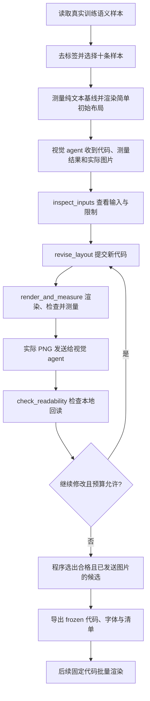

# DensePage 排版优化 Agent

这个 agent 用于模块二的一次性初始化：从十条真实训练样本和一个简单的上下分区布局出发，通过修改 Python 排版代码、查看实际生成的图片、测量目标模型的输入 token、检查图片回读，搜索适用于该数据集的通用排版策略。

最终保存选中的 `frozen/layout.py`、字体和冻结清单。之后生成训练集、验证集和测试集图片时，只调用这个固定代码，不再请求 agent。当前已选中的 compact 代码见 [`selected/compact.py`](../selected/compact.py)，调用说明见 [selected README](../selected/README.md)。

## 1. 用途与优化目标

DensePage 是后续推荐相关性与重排序模型的 **SFT/GRPO 训练输入**。排版需要同时考虑文字可识别性、用户证据与物品字段的结构，以及图像输入的 token 成本。

系统提示要求 agent：

- 先形成可靠可读的训练输入，再尝试降低 token。
- 保留清楚的字段标签、字段边界、段落结构和必要的区域间距。
- 避免过紧行距、频繁断词，以及将不相关字段无区分地挤成连续文字。
- 同时查看两个区域、最差样本和平均分；识别下降时先恢复清晰度。
- 不把 90% 回读门槛当作应当逼近的目标，不为少量 token 收益明显牺牲可识别性。
- 在每次代码修改的理由中解释对识别、字段结构与 token 的预期影响。

行高允许固定或自适应，**不强制每行前进 16px**。字体、字号、大标题和分区栏则在初始化后固定。

这些是 agent 的搜索指导。程序的实际选优规则是：先检查候选是否合格，再按真实视觉 token 排序，具体见第 5 节。图片回读是可识别性的代理指标，训练与推荐效果需要下游实验验证。

## 2. 输入与运行角色

### 输入样本

使用模块一产生的 `train_candidates.jsonl`。每条至少包含：

| 字段 | 含义 |
| --- | --- |
| `split` | 必须是 `train` |
| `user_context` | 用户画像和历史上下文文字 |
| `candidate_payload` | 一个候选物品的字段对象 |

程序在规范化字段后去重，并按文本长度分层选择十条样本，覆盖最短和最长输入。至少需要十条不同的样本；文件中出现验证或测试记录会被拒绝。标签、推荐分数、目标 ID 和原始样本编号不会提供给 agent，样本重新编号为 `example_01` 至 `example_10`。

所有候选使用同一组十条样本。搜索的是**一个可复用的排版程序**，不为每条样本分别保存一套布局，也不允许记忆样本文字或按样本编号特判。

### 三种角色

| 角色 | 做什么 | 是否需要本地模型权重 |
| --- | --- | --- |
| 视觉 agent | 通过 API 阅读文字和真实 PNG，决定如何修改排版代码及调用工具 | 不需要；服务模型须支持图片输入和工具调用 |
| 目标模型 processor/tokenizer | 对同协议的纯文本输入和图片输入计算真实 token | 不需要，只需本地 processor/tokenizer 文件 |
| 本地回读模型 | 独立转写图片的用户区、物品区，检查可识别性 | 需要；默认使用本地 Qwen3-VL，设备为 `cuda:0` |

视觉 agent 使用 OpenAI-compatible Chat Completions，通过 `httpx` 完成多模态输入和 function calling，不依赖额外 agent 框架。本地回读模型不会收到原文答案或相关性标签，只收到图片和固定转写指令。

## 3. 定义的四个工具

工具的 API schema 定义在 [`agent.py`](agent.py) 的 `TOOLS` 中，执行逻辑在 [`tools.py`](tools.py) 的 `LayoutSession` 中。agent 只可以调用以下四个工具。

| 工具 | 参数 | 主要作用 | 主要返回内容 |
| --- | --- | --- | --- |
| `inspect_inputs` | 无 | 查看本次搜索的输入、限制和状态 | 十条样本、字体约束、纯文本 token 基线、初始代码、候选 ID 和当前最佳候选 |
| `revise_layout` | `source`, `reason` | 保存一份完整的新排版程序 | `candidate_id`、源码哈希；重复源码会复用已有 ID |
| `render_and_measure` | `candidate_id` | 实际执行代码、渲染图片并测量 token | 每条图片的尺寸、哈希、内容/边界检查、真实 token、候选汇总；实际 PNG 随后发送给 agent |
| `check_readability` | `candidate_id` | 用本地目标 VLM 转写图片并检查两个区域 | 转写文本、用户区/物品区相似度、通过状态、汇总和当前最佳候选 |

### 3.1 `inspect_inputs`：了解输入和搜索状态

调用参数：

```json
{}
```

返回信息包括：

- 十条去标签的用户、物品文档及其指纹。
- 初始化字体、字号、页面尺寸限制和固定装饰。
- `text_token_limits`：逐样本的实际纯文本输入 token 数。
- `max_length`、`readability_threshold`、回读模式和候选预算。
- `initial_source`：起始 `layout()` 代码。
- `candidate_ids` 和 `best`：已提交版本及当前最佳合格版本。

这个工具不修改代码、不重新渲染，也不加载模型权重。可在开始搜索时调用，也可在后续查看状态。

### 3.2 `revise_layout`：提交完整的排版代码

参数：

| 参数 | 类型 | 含义 |
| --- | --- | --- |
| `source` | string | 完整 Python 源码，须恰好定义 `layout(document, metrics, constraints)` |
| `reason` | string | 修改理由，说明对可识别性、字段结构和 token 的考虑 |

源码通过限制检查后，程序按内容生成 `candidate_id`，保存到 `candidates/<id>/layout.py`。相同源码复用原 ID，不重复占用候选预算；达到预算后拒绝新增候选。

**保存代码不等于完成评估。** 提交后还需调用 `render_and_measure`，默认还要调用 `check_readability`。

agent 可修改宽度、四边留白、行高、基线、行距、区域间距、换行、字段顺序、分组、组合标签和分隔符。用户原文和所有物品字段值必须完整保留；字体、配色和评分代码不由候选程序修改。排版接口见第 6 节。

### 3.3 `render_and_measure`：生成图片与真实 token 测量

调用参数形式：

```json
{"candidate_id": "<revise_layout 返回的 ID>"}
```

工具会：

1. 在独立工作进程中执行候选代码，并对相同输入执行两次，检查布局计划是否确定。
2. 由公共引擎从原始文档重建展示字段，检查字段及字符片段完整覆盖，拒绝丢失、重复、字段内乱序、文字溢出或行间遮挡。
3. 绘制真实 PNG，包含固定的大标题、蓝绿分区栏、字体和原文内容。
4. 调用目标 processor，计算完整图片输入的真实 token。
5. 逐样本比较图片总输入 token 与纯文本基线，并检查输入长度上限。
6. 保存 `evaluation.json`，返回逐样本记录和候选汇总。

逐样本记录包含 `width`、`height`、`image_sha256`、`geometry_valid`、`content_preserved`、`total_input_tokens`、`image_patch_tokens`、`pure_text_tokens`、`strictly_below_text` 和 `within_length_guard` 等字段。汇总包括 `mean_total_tokens`、`mean_image_tokens`、`max_image_tokens`、`token_qualified` 和 `qualified`。

JSON 工具消息之后，程序把每条样本的**实际 PNG** 作为多模态消息发送给视觉 agent。agent 据此检查文字拥挤、断词、字段边界和区域结构，无需单独的图片检查工具。

该工具只需 processor/tokenizer，不加载完整 VLM 权重。相同候选的重复调用会返回缓存的评估结果。默认启用回读门槛时，token 合格仍需等待回读检查才能成为最终合格候选。

### 3.4 `check_readability`：检查图片能否被目标模型读出

调用参数形式：

```json
{"candidate_id": "<已经成功渲染的候选 ID>"}
```

须先有有效的渲染结果。工具让本地未适配的目标 VLM 独立转写图片，输出：

```json
{"user": "用户区域的转写文字", "item": "物品区域的转写文字"}
```

程序将转写结果与实际绘制的对应区域文字比较。双方先进行 Unicode NFKC 规范化并移除空白，再用 `difflib.SequenceMatcher(..., autojunk=False).ratio()` 计算字符序列相似度。它不等同于标准 OCR 字符错误率，也不是推荐准确率。

默认要求每条样本的两个区域分别达到 0.90：

```text
每个样本：user_similarity >= 0.90 且 item_similarity >= 0.90
整个候选：十条样本全部满足
```

不能用平均分掩盖某条样本或某个区域的失败。转写 JSON 无法解析时，该条不通过。工具返回逐样本的 `transcription`、`section_similarity`、`parsed`、`passed`，以及整体合格状态和统计摘要。重复调用使用已有回读结果。

`readability_threshold=null` 时，转写分数仅作诊断，不参与候选合格判定；同时设置 `reader.enabled=false` 可完全关闭回读，此时不需要模型权重。默认配置保留回读检查。

## 4. 一次完整搜索如何执行



这是典型调用顺序，agent 可以反复查看输入、对失败版本调整规则或提前结束。初始布局由程序自动注册并渲染，也计入候选数。搜索期间维护已合格候选，后续尝试失败不会覆盖已有成功结果。

候选之间的比较、最终选择和冻结导出由宿主程序自动执行，不是额外的 agent 工具。结束时还会检查候选图片是否实际进入过一次 agent API 请求；只有数值报告、未发送图片的候选不能导出。

程序保存工具交互、模型返回的 usage 和评估记录。较早的图片会从后续请求中移除以控制上下文，图片文件保留；`agent_trace.json` 用图片哈希代替 base64 内容。

## 5. 合格条件与最终选优

每条初始化样本都须满足：

1. 固定的上下分区、大标题、蓝绿分区栏、字体和字号完整保留。
2. 原文与字段值完整，文字无溢出或遮挡，画布符合限制。
3. 图片方案的**总输入 token 严格少于同内容纯文本方案**，相等也不合格。
4. 总输入 token 不超过 `max_length`，默认 2048。
5. 回读门槛启用时，用户区、物品区各自达到配置阈值，默认 90%。

总输入 token 比较使用正式评分相同的 system/user 提示和 generation prompt。视觉 token 来自实际 processor 的图像占位 token 数，不用图片面积估算或图片文件大小代替。

最终只在合格、且图片已发送给 agent 的候选中，按以下顺序升序选择：

```text
平均真实视觉 token → 最大真实视觉 token → candidate_id
```

因此，可识别性既通过系统提示指导搜索，也通过逐区域回读门槛检查；**当前排序公式没有额外的连续可读性加权项**。达到门槛不代表已经证明下游训练质量，agent 仍须报告发现的识别或结构问题。

没有合格候选时保留记录并以失败状态结束，不导出 `frozen/`。得到的是本次样本和预算下的选中策略，不能据此声称全局最优。

## 6. Agent 最终修改什么代码

候选代码的入口固定为：

```python
def layout(document, metrics, constraints):
    width = 640
    padding = 12
    return {
        'width': width,
        'padding': padding,
        'line_gap': 4,
        'section_gap': 16,
        'user_rows': metrics.flow(document['user'], width - 2 * padding, pack=False),
        'item_rows': metrics.flow(document['item'], width - 2 * padding, pack=False),
    }
```

`document['user']` 和 `document['item']` 是字段列表，每个字段有 `id`、`text`；物品字段还含 `key`、`label`、`values` 元数据。候选输出布局计划，公共引擎负责最终绘图。每行使用 `[field_id, start, end]` 引用原文片段，避免用任意字符串替换真实内容。

候选源码可以包含基于文字长度和字体测量的循环、条件分支、分组与换行算法。它不只是一份参数 JSON，也不能任意修改仓库文件。可用辅助接口如下：

| 接口 | 用途 |
| --- | --- |
| `metrics.width(text)` | 测量固定正文字体下的文字宽度 |
| `metrics.flow(fields, width, pack=False, wrap='split')` | 按给定宽度生成原文片段行；可合并短字段、选择单词换行或拆分长词 |
| `metrics.prepare(document, presentation)` | 根据可验证的分组、标签和分隔符规则构建展示字段 |

这些是排版代码内部使用的辅助接口，不增加 agent 对外工具数量。详细可选字段和展示规则见文末附录。

公共引擎不开放字体、字号、颜色和固定装饰修改。候选程序不能删除、缩写、改写、隐藏或重复用户原文与物品字段值。源码使用受限制的 Python 子集，禁止导入、文件与网络访问等，并在有限 CPU、内存、输出和墙钟时间的进程中执行；这用于约束生成代码故障，不是面向恶意代码的操作系统安全沙箱。

## 7. 配置与运行

所有命令均从仓库根目录执行。配置文件为 [`configs/cd_lightgcn/layout_optimizer.json`](../../configs/cd_lightgcn/layout_optimizer.json)。

| 配置项 | 作用 | 示例默认值 |
| --- | --- | --- |
| `initial_layout` | 简单初始排版源码 | `optical_compression/layouts/initial.py` |
| `agent.model` | 支持图片输入及工具调用的视觉模型 | `gpt-4o` |
| `agent.base_url_env`, `agent.api_key_env` | 读取服务地址与凭证的环境变量名 | `OPENAI_BASE_URL`, `OPENAI_API_KEY` |
| `agent.max_completion_tokens` | 单次 agent 响应输出预算 | 8192 |
| `constraints` | 固定字体、字号和画布范围 | 正文 14px，分区标题 15px，大标题 18px |
| `reader.enabled`, `reader.device` | 是否启用本地回读及执行设备 | `true`, `cuda:0` |
| `reader.max_new_tokens` | 单张图片的转写输出预算 | 4096 |
| `readability_threshold` | 两个区域各自的最低回读相似度 | 0.90 |
| `max_candidates` | 不同候选源码总数上限，含初始版本 | 20 |
| `max_turns` | agent API 交互次数上限，不等同于候选数 | 40 |
| `max_length` | 单个样本的完整输入长度上限 | 2048 |

默认字体随仓库提供。初始化时可以用 `font_path`、`bold_font_path` 更换为覆盖数据语言的字体，路径相对运行时工作目录；一旦开始搜索，字体和字号不再改变。字体缺少数据字符时会明确失败。

### 先检查输入与初始布局

```bash
python -m optical_compression.optimize \
  --config configs/cd_lightgcn/layout_optimizer.json \
  --samples artifacts/cd_prepare/datasets/train_candidates.jsonl \
  --model data/models/Qwen3-VL-8B-Instruct \
  --output artifacts/layout_cd_preview \
  --prepare-only
```

这一步不请求 agent API、不加载 VLM 权重。输出实际纯文本基线、初始图片和 token 测量。可选的 `text_token_limits` 配置必须与本次实际基线完全相同，程序会核对，不能借用其他提示或模型的 token 数。

### 执行搜索

先在配置中填写模型名称，并通过环境变量提供服务地址与 API 凭证：

```bash
export CUDA_VISIBLE_DEVICES=0
export OPENAI_BASE_URL='https://api.openai.com/v1'
# 在当前环境中设置 OPENAI_API_KEY。
python -m optical_compression.optimize \
  --config configs/cd_lightgcn/layout_optimizer.json \
  --samples artifacts/cd_prepare/datasets/train_candidates.jsonl \
  --model data/models/Qwen3-VL-8B-Instruct \
  --output artifacts/layout_cd_search
```

服务也可使用 ZenMux 等兼容接口。例如 ZenMux 地址为 `https://zenmux.ai/api/v1`，使用 gpt-5.5 时将 `agent.model` 配置为 `openai/gpt-5.5`。凭证通过环境变量读取，不写入配置文件或仓库。搜索请求会把选中样本的文字和图片发送给所配置的视觉服务。

默认最多 20 个候选、40 次交互，agent 也可提前结束。若希望最多尝试三个新版本，可设置 `max_candidates=4`，并提供足够的 `max_turns` 完成渲染、看图和回读；初始布局占一个候选名额。

每次使用新的输出目录。当前入口记录会话，但不支持从中断处恢复 agent 对话；没有完整结果时检查搜索日志后使用新的目录运行。

## 8. 输出文件与后续固定调用

```text
artifacts/layout_cd_search/
├── run_config.json            # 运行配置、输入与配置文件指纹
├── initialization.json        # 十条输入、固定约束、纯文本基线和 processor 指纹
├── candidates/<id>/
│   ├── layout.py              # 该候选的完整源码
│   ├── example_01.png         # 真实渲染图片，同目录包含其他样本
│   └── evaluation.json        # 内容、边界、token 与回读评估
├── agent_trace.json           # 工具调用和 API usage，图片以哈希记录
├── best.json                  # 当前或最终选中的候选
├── search_summary.json        # 全部候选及最终结果
└── frozen/                    # 仅成功选出合格候选后产生
    ├── layout.py              # 后续固定调用的选中代码
    ├── layout.json            # 字体、源码、引擎、processor、条件与评估指纹
    └── fonts/                 # 固定正文/粗体字体及可用的许可文件
```

选中后批量生成三个数据划分：

```bash
python -m optical_compression.pipeline \
  --datasets artifacts/cd_prepare/datasets \
  --layout artifacts/layout_cd_search/frozen \
  --model data/models/Qwen3-VL-8B-Instruct \
  --output artifacts/cd_densepage
```

这个命令只加载选中排版代码和目标 processor，不调用 agent、不需要 API 凭证，也不重新执行本地 VLM 回读。它核对源码、字体、引擎及 processor 指纹，对全部输入检查长度和严格少于纯文本的要求；不满足时明确失败，不静默截断或按验证/测试表现重新搜索。

完整的“原始数据 → 语义准备 → agent 选择 → 固定代码渲染 → 训练评估”入口为：

```bash
python run_pipeline.py --config configs/cd_lightgcn/pipeline_agent.json
```

[`pipeline_agent.json`](../../configs/cd_lightgcn/pipeline_agent.json) 用 `layout_optimizer_config` 指定选择过程；已选好代码时则用 `layout_strategy` 指定目录。两者互斥。当前已选代码位于 [`selected/`](../selected/README.md)，后续可直接加载该目录。更换排版策略时应使用独立输出目录，并重新生成下游训练输入和缓存。

原始数据、处理数据、搜索记录、PNG 与训练产物保留在本地，不随仓库分发。

## 9. 实现位置与检查

| 文件 | 职责 |
| --- | --- |
| [`optimize.py`](../optimize.py) | 读取配置和样本，初始化测量/回读组件，启动搜索 |
| [`agent.py`](agent.py) | 系统提示、四个工具 schema、HTTP 客户端、多轮调用、实际图片反馈与最终导出协调 |
| [`tools.py`](tools.py) | 四个工具实现、候选状态、硬约束评估、选优和冻结包保存 |
| [`document.py`](../document.py) | 文本规范化、样本去重与选择、纯文本基线内容 |
| [`layout_engine.py`](../layout_engine.py) | 字体测量、原文片段验证、固定装饰绘制、冻结代码重放 |
| [`layout_worker.py`](../layout_worker.py) | 在受限资源进程中执行候选代码 |
| [`presentation.py`](../presentation.py) | 字段展示规则与原值完整性验证 |
| [`measurement.py`](../measurement.py) | 真实 processor token 测量与独立 VLM 转写、相似度计算 |
| [`strategy.py`](../strategy.py) | 为后续批量入口加载选中代码，不导入 agent |

离线检查命令：

```bash
python -m unittest tests.test_layout_optimizer
```

测试使用临时合成样本和模拟服务，覆盖工具协议、真实 Pillow 渲染、图片反馈、内容与几何边界、失败拒绝、冻结重放、三个数据划分的接入，以及批量阶段不导入 agent。它不代替真实视觉服务、本地 VLM 和后续 SFT/GRPO 的完整实验。

## 附录：排版规则接口

布局计划的必填字段为 `width`、`padding`、`line_gap`、`section_gap`、`user_rows` 和 `item_rows`。以下字段可选，省略时使用引擎默认值：

| 字段 | 含义 |
| --- | --- |
| `margins` | `{left, right, top, bottom}`，四项齐全时替代 `padding` 的默认留白；左右至少 8px，上下为 4–512px |
| `line_height` | 固定每行前进像素数（1–256），再叠加 `line_gap`；null 时按该行字形高度计算 |
| `text_anchor` | `lt` 按字形顶部排；`la` 按共同字体基线排 |
| `text_origin` | `ink` 补偿负的左侧字形偏移；`font` 使用字体原点 |
| `height_multiple` | 将最终高度向上对齐到指定倍数（1–256）；32 可表达原 compact 的高度对齐 |
| `min_height` | 页面最小高度，默认 32px |
| `trim_rows` | 仅去掉每行首尾空白后绘制；原文片段覆盖检查仍完整进行 |
| `presentation` | 由原字段构造展示字段的规则，公共引擎从原始输入独立重建并验证 |

`metrics.flow(fields, width, pack=False, wrap='split')` 保留拆分长词的原有行为。`wrap='words'` 在单词边界换行，并须搭配 `trim_rows=True`；完整单词超过可用宽度时明确失败，不允许溢出。也可自行实现换行算法，再提交合法的原文片段。

`presentation` 按 `user` / `item` 指定分组列表。叶子组用 `ids` 引用原字段，`separator` 决定字段间分隔符，`joins={后续字段ID: 分隔符}` 可逐字段覆盖。用户文字完整保留。物品组还支持：

- `label`：展示标签；单字段默认原标签，合并字段时必须显式提供非空组合标签，标签含义须准确对应原字段。
- `list_separator`：列表值的分隔符，默认 `; `，可用 `, ` 等。
- `empty_value`：空列表显示 `Unknown` 或空串。
- `skip_empty`：仅跳过空值；任何非空值均不能省略。

容器组使用 `groups=[子组, ...]` 和 `separator` 连接子组，最多嵌套四层，可表达一个段落里多个带标签字段用 ` • ` 分隔。分隔符限 1–16 个空格或标点（逗号、分号、冒号、斜线、竖线、圆点、括号、破折号），不接受隐藏控制字符或替代原值的文本模板。所有源字段在所属区域须恰好出现一次。

```python
presentation = {
    'item': [
        {'ids': ['i0'], 'label': 'Title'},
        {'groups': [
            {'ids': ['i1'], 'label': 'Artists', 'list_separator': ', '},
            {'ids': ['i2', 'i3'], 'label': 'Era / styles', 'separator': '; ',
             'list_separator': ', '},
        ], 'separator': ' • '},
    ],
}
fields = metrics.prepare(document, presentation)
# 用 fields['user'] / fields['item'] 生成 rows，并在最终 plan 中带上同一个 presentation。
```

上例假定恰有这四个物品字段。实际布局应按 `field['key']` 构造分组，并覆盖新数据集的所有字段。准备后的分组字段 ID 是 `user_g0`、`item_g0` 等；未配置的区域仍使用原字段。引擎先验证所有字段值均保留，再验证准备后字符片段的完整覆盖；回读对照为实际显示的文字。
